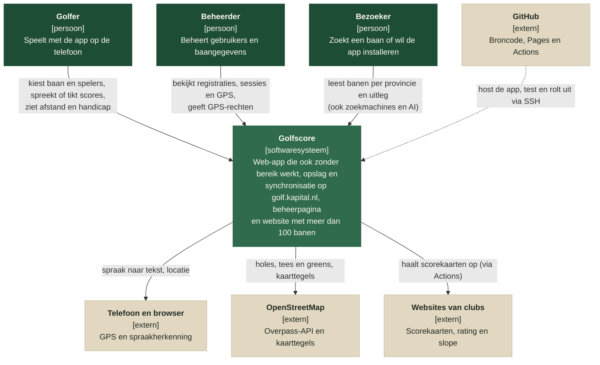

# Architectuur

## C1 – systeemcontext

Wie gebruikt Golfscore, en met welke systemen buiten de app praat het. Een uitgebreidere
versie met uitleg per relatie staat in [c1-systeemcontext.html](c1-systeemcontext.html).

